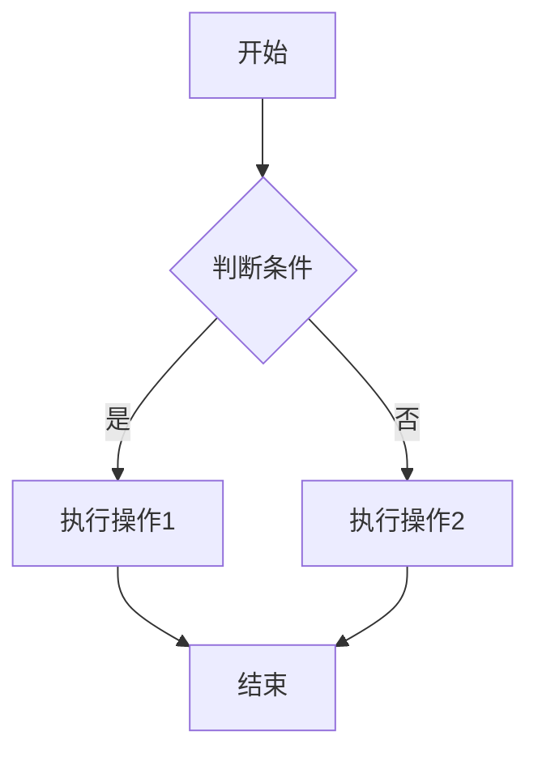
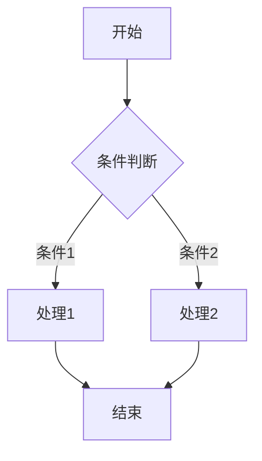
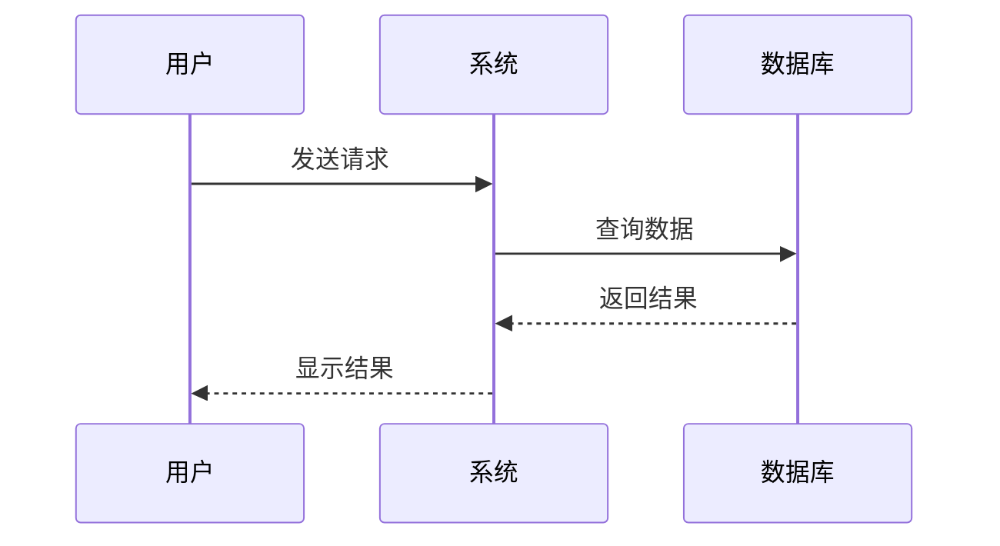
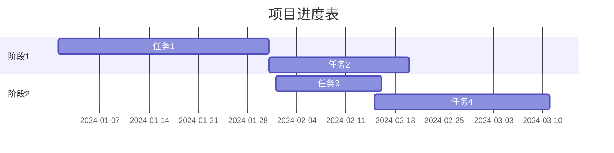

# Mermaid 高清流程图生成器

使用 Mermaid CLI 将 Mermaid 代码导出为高清 SVG、PNG、PDF 格式的流程图。

## 📋 功能特点

- ✅ **SVG 矢量格式** - 无损缩放，永远高清
- ✅ **多格式导出** - 支持 SVG、PNG、PDF
- ✅ **批量生成** - 一次性处理多个文件
- ✅ **自定义配置** - 主题、背景、尺寸等
- ✅ **简单易用** - 命令行一键生成

## 🚀 快速开始

### 1. 安装依赖

```bash
# 安装 Node.js 依赖
npm install

# 全局安装 Mermaid CLI（推荐）
npm install -g @mermaid-js/mermaid-cli
```

或者使用本地安装：

```bash
npm install --save-dev @mermaid-js/mermaid-cli
```

### 2. 创建 Mermaid 文件

在 `examples` 文件夹中创建 `.mmd` 文件，例如 `flowchart.mmd`：



### 3. 生成流程图

#### 方法一：使用 npm scripts（推荐）

```bash
# 生成 SVG（矢量格式，高清）
npm run generate

# 生成 PNG（2048px 宽度，高清）
npm run generate-png

# 生成 PDF
npm run generate-pdf

# 一次生成所有格式
npm run generate-all
```

#### 方法二：直接使用 mmdc 命令

```bash
# 基本用法：生成 SVG
mmdc -i input.mmd -o output.svg

# 生成高清 PNG（指定宽度）
mmdc -i input.mmd -o output.png -w 2048 -H 1536

# 使用自定义配置
mmdc -i input.mmd -o output.svg -c config.json

# 指定主题和背景
mmdc -i input.mmd -o output.svg -t dark -b transparent
```

#### 方法三：批量生成

```bash
# 批量处理 examples 文件夹中的所有 .mmd 文件
npm run batch-generate
```

## 📁 项目结构

```
mermaid/
├── examples/           # 存放 Mermaid 源文件 (.mmd)
│   ├── flowchart.mmd
│   ├── sequence.mmd
│   └── ...
├── output/            # 生成的图片输出目录
│   ├── flowchart.svg
│   ├── flowchart.png
│   └── ...
├── scripts/           # 辅助脚本
│   └── batch-generate.js
├── config.json        # Mermaid 配置文件
├── package.json
└── README.md
```

## ⚙️ 配置说明

### config.json 配置文件

```json
{
  "theme": "default",
  "themeVariables": {
    "primaryColor": "#4A90E2",
    "primaryTextColor": "#fff",
    "primaryBorderColor": "#357ABD",
    "lineColor": "#666",
    "secondaryColor": "#006100",
    "tertiaryColor": "#fff"
  },
  "flowchart": {
    "curve": "basis",
    "padding": 20
  }
}
```

### 常用参数说明

- `-i, --input` : 输入的 Mermaid 文件
- `-o, --output` : 输出文件路径
- `-t, --theme` : 主题 (default, forest, dark, neutral)
- `-b, --backgroundColor` : 背景颜色 (transparent, white, #RRGGBB)
- `-w, --width` : 输出宽度（PNG 格式）
- `-H, --height` : 输出高度（PNG 格式）
- `-c, --configFile` : 配置文件路径
- `-s, --scale` : 缩放比例（PNG 格式，默认为 1）

## 📊 Mermaid 图表类型示例

### 流程图 (Flowchart)



### 时序图 (Sequence Diagram)



### 甘特图 (Gantt Chart)



## 💡 最佳实践

### 1. 生成高清图片

**SVG（推荐）**：
```bash
mmdc -i input.mmd -o output.svg -b transparent
```
- 矢量格式，无限缩放不失真
- 文件体积小
- 适合网页和文档

**PNG（高分辨率）**：
```bash
mmdc -i input.mmd -o output.png -w 3840 -b white
```
- 指定较大宽度（如 2048、3840）
- 适合打印和演示

**PDF（矢量）**：
```bash
mmdc -i input.mmd -o output.pdf
```
- 矢量格式，适合文档嵌入

### 2. 自定义主题

创建 `config.json` 文件：

```json
{
  "theme": "base",
  "themeVariables": {
    "primaryColor": "#FF6B6B",
    "primaryTextColor": "#fff",
    "primaryBorderColor": "#CC5555",
    "lineColor": "#F5A623",
    "secondaryColor": "#4ECDC4",
    "tertiaryColor": "#FFE66D",
    "fontSize": "16px",
    "fontFamily": "微软雅黑, Arial"
  }
}
```

然后使用：
```bash
mmdc -i input.mmd -o output.svg -c config.json
```

### 3. 批量处理

使用提供的批量脚本：
```bash
npm run batch-generate
```

或创建自己的批处理脚本（Windows）：
```batch
@echo off
for %%f in (examples\*.mmd) do (
    mmdc -i "%%f" -o "output\%%~nf.svg" -t default -b transparent
    echo 已生成: %%~nf.svg
)
```

## 🔧 常见问题

### 1. 中文显示乱码

在配置文件中设置中文字体：

```json
{
  "themeVariables": {
    "fontFamily": "Microsoft YaHei, SimHei, Arial"
  }
}
```

### 2. 图片被截断

增加 padding 或手动指定尺寸：

```json
{
  "flowchart": {
    "padding": 40
  }
}
```

或使用命令行参数：
```bash
mmdc -i input.mmd -o output.png -w 2048 -H 1536
```

### 3. Puppeteer 安装失败

如果在中国网络环境下安装失败，可以设置镜像：

```bash
# 设置 Puppeteer 镜像
set PUPPETEER_DOWNLOAD_HOST=https://cdn.npmmirror.com/binaries/chrome-for-testing

# 然后再安装
npm install -g @mermaid-js/mermaid-cli
```

## 📚 参考资源

- [Mermaid 官方文档](https://mermaid.js.org/)
- [Mermaid CLI GitHub](https://github.com/mermaid-js/mermaid-cli)
- [Mermaid 在线编辑器](https://mermaid.live/)

## 📄 许可证

MIT License

