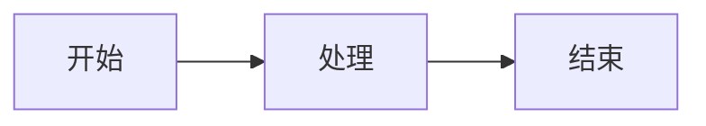

# 🚀 快速开始指南

## 第一步：安装 Node.js

如果还没有安装 Node.js，请先下载安装：
- 官网：https://nodejs.org/
- 推荐安装 LTS 版本

验证安装：
```bash
node --version
npm --version
```

## 第二步：安装 Mermaid CLI

打开命令行（PowerShell 或 CMD），执行：

```bash
npm install -g @mermaid-js/mermaid-cli
```

**遇到网络问题？** 使用国内镜像：
```bash
# 设置镜像
set PUPPETEER_DOWNLOAD_HOST=https://cdn.npmmirror.com/binaries/chrome-for-testing

# 再次安装
npm install -g @mermaid-js/mermaid-cli
```

验证安装：
```bash
mmdc --version
```

## 第三步：创建你的第一个流程图

1. 在 `examples` 文件夹中创建一个 `test.mmd` 文件

2. 输入以下内容：



3. 保存文件

## 第四步：生成流程图

### 方法一：使用图形界面（最简单）

双击运行 `generate.bat` 文件，按照菜单提示操作。

### 方法二：使用命令行

```bash
# 生成 SVG（推荐，矢量格式）
mmdc -i examples/test.mmd -o output/test.svg

# 生成高清 PNG
mmdc -i examples/test.mmd -o output/test.png -w 2048

# 生成 PDF
mmdc -i examples/test.mmd -o output/test.pdf
```

### 方法三：批量生成

处理 `examples` 文件夹中的所有 `.mmd` 文件：

```bash
node scripts/batch-generate.js
```

## 第五步：查看结果

生成的图片会保存在 `output` 文件夹中，用浏览器或图片查看器打开即可。

## 常用命令速查

| 命令 | 说明 |
|------|------|
| `mmdc -i input.mmd -o output.svg` | 生成 SVG |
| `mmdc -i input.mmd -o output.png -w 2048` | 生成 2048px 宽的 PNG |
| `mmdc -i input.mmd -o output.pdf` | 生成 PDF |
| `mmdc -i input.mmd -o output.svg -t dark` | 使用深色主题 |
| `mmdc -i input.mmd -o output.svg -b white` | 白色背景 |
| `mmdc -i input.mmd -o output.svg -c config.json` | 使用自定义配置 |

## 主题选项

- `default` - 默认主题（浅色）
- `forest` - 森林主题（绿色）
- `dark` - 深色主题
- `neutral` - 中性主题
- `base` - 基础主题（可自定义颜色）

## 下一步

- 查看 `README.md` 了解更多功能
- 查看 `examples` 文件夹中的示例
- 修改 `config.json` 自定义样式
- 访问 https://mermaid.js.org/ 学习更多 Mermaid 语法

## 需要帮助？

- Mermaid 官方文档：https://mermaid.js.org/
- Mermaid 在线编辑器：https://mermaid.live/
- Mermaid CLI 文档：https://github.com/mermaid-js/mermaid-cli

