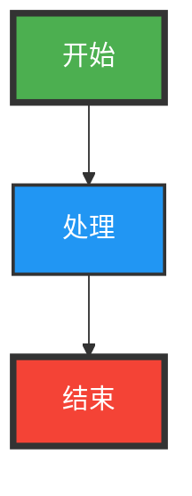
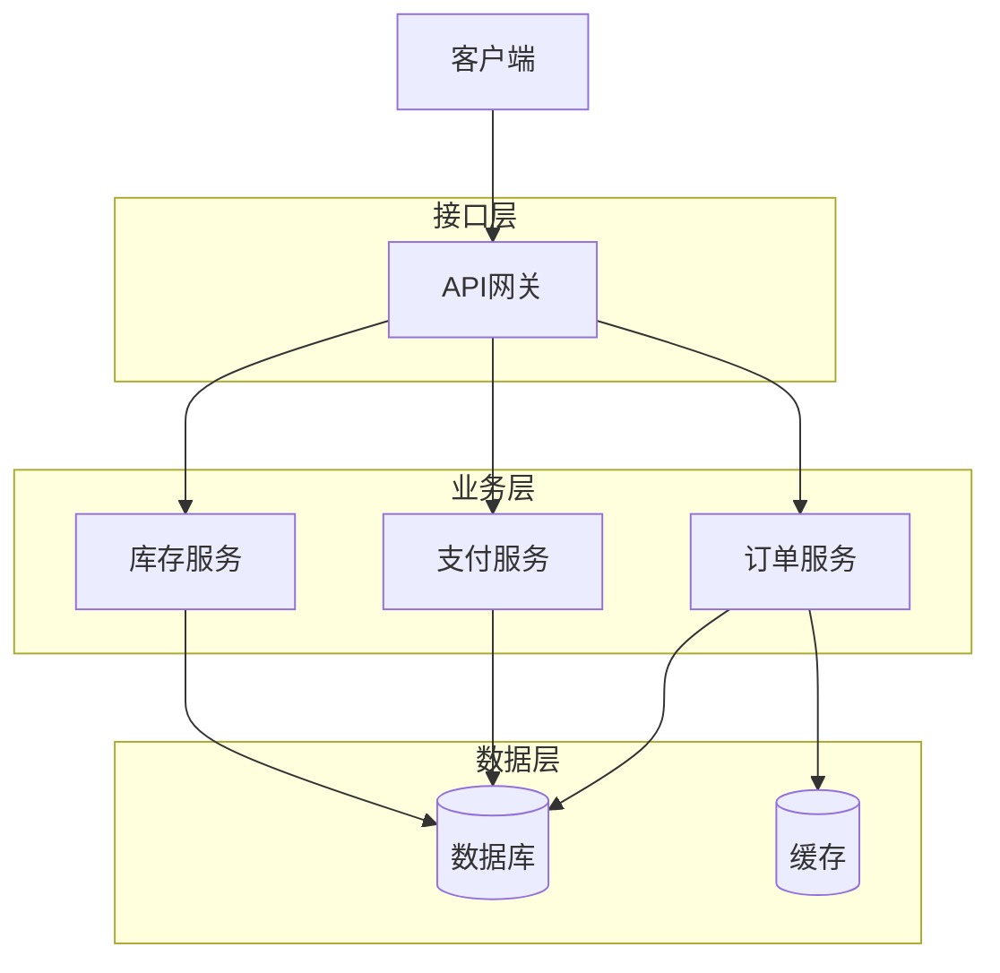
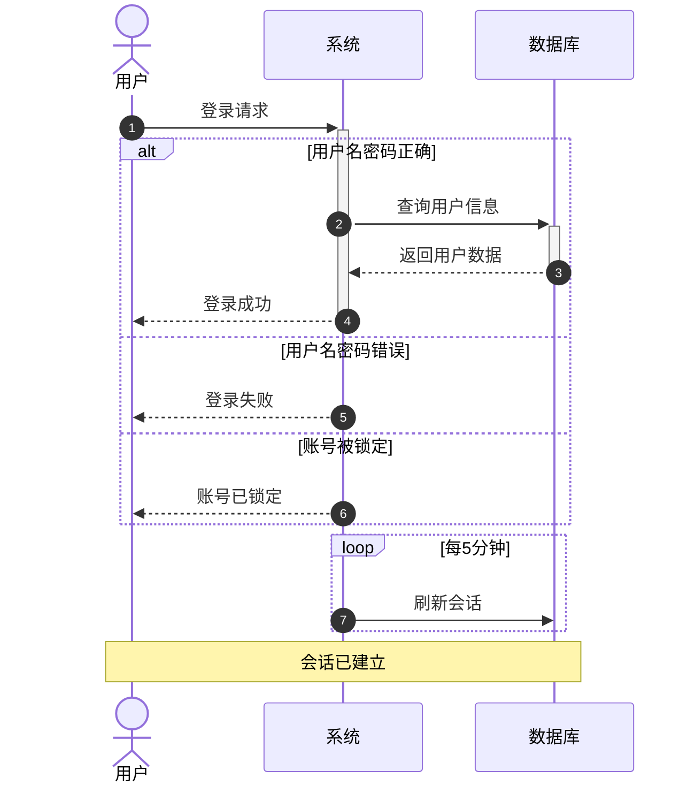
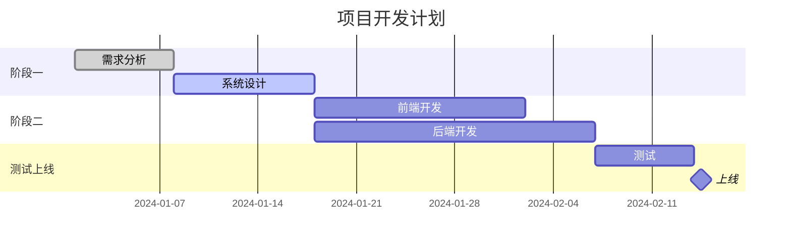
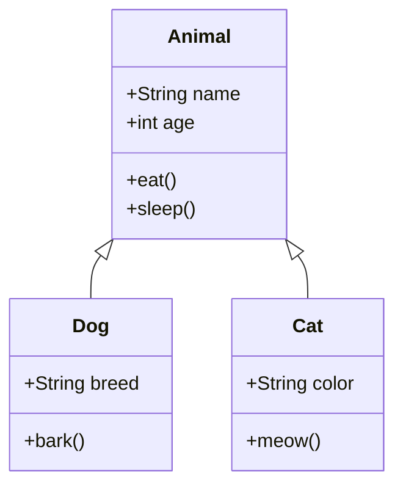

# 🎯 Mermaid 高级技巧

## 一、生成超高清图片

### 1. SVG 矢量格式（推荐）

SVG 是矢量格式，无论如何缩放都不会失真，最适合生成高清流程图。

```bash
mmdc -i input.mmd -o output.svg -b transparent
```

**优点：**
- ✅ 无限缩放不失真
- ✅ 文件体积小
- ✅ 可以在浏览器中直接编辑
- ✅ 适合网页和文档嵌入

### 2. PNG 高分辨率

如果需要 PNG 格式，可以指定更大的宽度：

```bash
# 2K 分辨率
mmdc -i input.mmd -o output.png -w 2048

# 4K 分辨率
mmdc -i input.mmd -o output.png -w 3840

# 指定宽度和高度
mmdc -i input.mmd -o output.png -w 2048 -H 1536
```

### 3. 缩放比例

使用 scale 参数提高清晰度：

```bash
# 2倍缩放（更清晰）
mmdc -i input.mmd -o output.png -s 2

# 3倍缩放（超清晰）
mmdc -i input.mmd -o output.png -s 3
```

## 二、自定义样式和主题

### 1. 使用内置主题

```bash
# 默认主题
mmdc -i input.mmd -o output.svg -t default

# 森林主题（绿色）
mmdc -i input.mmd -o output.svg -t forest

# 深色主题
mmdc -i input.mmd -o output.svg -t dark

# 中性主题
mmdc -i input.mmd -o output.svg -t neutral
```

### 2. 自定义配置文件

创建 `config.json`：

```json
{
  "theme": "base",
  "themeVariables": {
    "primaryColor": "#FF6B6B",
    "primaryTextColor": "#ffffff",
    "primaryBorderColor": "#CC5555",
    "lineColor": "#F5A623",
    "secondaryColor": "#4ECDC4",
    "tertiaryColor": "#FFE66D",
    "background": "#ffffff",
    "mainBkg": "#4A90E2",
    "secondBkg": "#52C41A",
    "mainContrastColor": "#ffffff",
    "darkMode": false,
    "fontSize": "18px",
    "fontFamily": "Microsoft YaHei, Arial"
  },
  "flowchart": {
    "curve": "basis",
    "padding": 40,
    "nodeSpacing": 80,
    "rankSpacing": 80,
    "diagramPadding": 30
  }
}
```

使用配置：

```bash
mmdc -i input.mmd -o output.svg -c config.json
```

### 3. 在 Mermaid 代码中直接定义样式



## 三、处理中文字体

### 问题：中文显示为方框或乱码

**解决方案 1：在配置文件中设置中文字体**

```json
{
  "themeVariables": {
    "fontFamily": "Microsoft YaHei, SimHei, SimSun, Arial, sans-serif"
  }
}
```

**解决方案 2：确保系统已安装中文字体**

Windows 系统通常已经包含以下字体：
- Microsoft YaHei（微软雅黑）
- SimHei（黑体）
- SimSun（宋体）

## 四、批量处理技巧

### 1. 使用 Node.js 脚本（跨平台）

`scripts/batch-generate.js` 已经提供了批量处理功能：

```bash
node scripts/batch-generate.js
```

### 2. Windows 批处理脚本

创建 `batch-convert.bat`：

```batch
@echo off
echo 开始批量转换...

for %%f in (examples\*.mmd) do (
    echo 处理: %%f
    mmdc -i "%%f" -o "output\%%~nf.svg" -t default -b transparent
    mmdc -i "%%f" -o "output\%%~nf.png" -w 2048 -b white
)

echo 转换完成！
pause
```

### 3. 不同格式批量生成

修改 `batch-generate.js` 中的配置：

```javascript
const config = {
  inputDir: './examples',
  outputDir: './output',
  formats: ['svg', 'png', 'pdf'], // 添加更多格式
  theme: 'forest', // 更改主题
  backgroundColor: 'white', // 更改背景
  pngWidth: 3840, // 4K 分辨率
};
```

## 五、高级 Mermaid 语法

### 1. 复杂流程图



### 2. 时序图高级特性



### 3. 甘特图



### 4. 类图



## 六、性能优化

### 1. 大型图表优化

对于节点很多的复杂图表：

```json
{
  "flowchart": {
    "htmlLabels": false,
    "useMaxWidth": false
  }
}
```

### 2. 减少文件大小

```bash
# SVG 优化（需要安装 svgo）
npm install -g svgo
svgo input.svg -o output-optimized.svg
```

### 3. 并行处理

修改批处理脚本，使用 Promise.all 并行处理：

```javascript
const promises = mmdFiles.map(file => {
  return new Promise((resolve, reject) => {
    // 处理逻辑
  });
});

await Promise.all(promises);
```

## 七、导出选项完整参考

```bash
mmdc \
  -i input.mmd \              # 输入文件
  -o output.svg \             # 输出文件
  -t default \                # 主题
  -b transparent \            # 背景颜色
  -w 2048 \                   # 宽度（PNG）
  -H 1536 \                   # 高度（PNG）
  -s 2 \                      # 缩放比例
  -c config.json \            # 配置文件
  --puppeteerConfigFile puppeteer-config.json  # Puppeteer 配置
```

## 八、集成到工作流

### 1. Git Hooks

在 `.git/hooks/pre-commit` 中自动生成图表：

```bash
#!/bin/bash
node scripts/batch-generate.js
git add output/
```

### 2. CI/CD 集成

在 GitHub Actions 中：

```yaml
name: Generate Diagrams

on: [push]

jobs:
  generate:
    runs-on: ubuntu-latest
    steps:
      - uses: actions/checkout@v2
      - uses: actions/setup-node@v2
      - run: npm install -g @mermaid-js/mermaid-cli
      - run: node scripts/batch-generate.js
      - uses: actions/upload-artifact@v2
        with:
          name: diagrams
          path: output/
```

## 九、常见问题解决

### 1. 图表被截断

增加 padding：

```json
{
  "flowchart": {
    "padding": 50,
    "diagramPadding": 30
  }
}
```

或手动指定尺寸：

```bash
mmdc -i input.mmd -o output.png -w 2048 -H 2048
```

### 2. Puppeteer 安装失败

```bash
# Windows
set PUPPETEER_DOWNLOAD_HOST=https://cdn.npmmirror.com/binaries/chrome-for-testing

# Linux/Mac
export PUPPETEER_DOWNLOAD_HOST=https://cdn.npmmirror.com/binaries/chrome-for-testing

npm install -g @mermaid-js/mermaid-cli
```

### 3. 内存不足

对于超大图表，增加 Node.js 内存：

```bash
node --max-old-space-size=4096 scripts/batch-generate.js
```

## 十、在线资源

- **Mermaid Live Editor**：https://mermaid.live/
  - 实时预览
  - 在线编辑
  - 直接导出

- **官方文档**：https://mermaid.js.org/
  - 完整语法参考
  - 示例库

- **VS Code 插件**：搜索 "Mermaid Preview"
  - 实时预览
  - 语法高亮
  - 自动补全

祝你使用愉快！🎉

